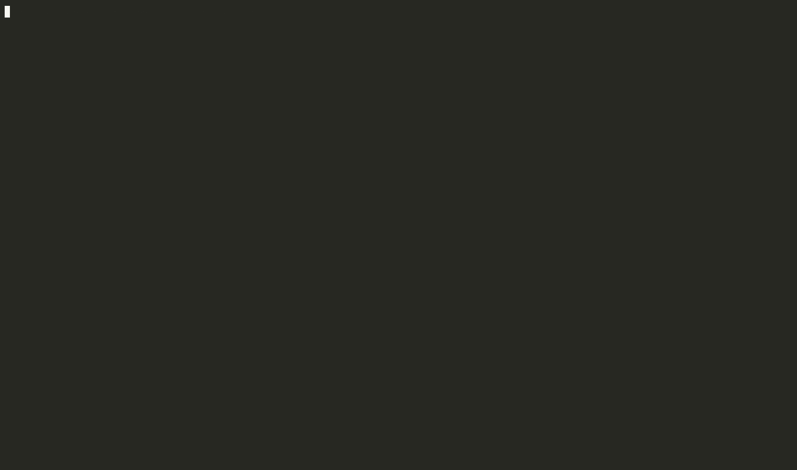

> **Status: Proof of Concept (Alpha)**
>
> Atlas is in early development. APIs may change. Feedback welcome!

# Atlas

> "There is no reason to limit our specifications to what we can prove, yet that is primarily what type systems do. There is so much more we want to communicate and verify about our systems."
>
> — [clojure.org/about/spec](https://clojure.org/about/spec#_expressivity_proof)

A semantic registry for software architecture. Describe your system's components, functions, and relationships using **compound identities** (sets of semantic aspects), then query, validate, and visualize your architecture as a single queryable graph.


## The Problem

Understanding, maintaining, and communicating system design are constant challenges in any medium-to-large project. Complexity grows with every new feature, rule, or condition, eventually overwhelming developers with unmanageable cognitive load.

In most software systems, "identity" is bound to **place** - a thing's name implies where it lives (folder, file, namespace, memory address). This is an accident of hardware history, not a conceptual necessity.

What if identity was determined by **semantics** - what something means and how it relates to other things?

## What Atlas Does

Atlas offers a semantic registry and tooling layer for software architecture: you describe any system entities,  like components, functions, endpoints, protocols,  business concepts ...  as **compound identities** (sets of aspects) plus structured properties - without thinking about implementation details.

```clojure
;; registry/functions.edn: what the function is, as data
{:fn/validate-token                         ; dev-id (for humans)
 {:atlas/type :atlas/execution-function     ; entity type
  :atlas/aspects #{:domain/auth             ; semantic aspects
                   :operation/validate
                   :tier/service}
  :execution-function/context [:auth/token]
  :execution-function/response [:auth/valid? :auth/user-id]
  :execution-function/deps #{:component/oauth-provider}}}
```

```clojure
;; src/app/auth.clj: the code stays a plain defn, naming its entity
(defn ^{:atlas.source/id :fn/validate-token} validate-token
  [{:auth/keys [token]}]
  ...)
```

From this registry, Atlas can:
- **Query** - Find all entities in `:domain/auth`, all `:tier/service` functions, etc.
- **Validate** - Check that data flows are satisfiable, dependencies exist, tiers are respected
- **Visualize** - Explore the semantic graph interactively
- **Document** - Generate architecture docs from the registry
- **Diff** - Compare with previous registry version

It's a **data-first approach** where the system's structure is queryable, visualizable, and validated via a shared ontology - rather than hard-coded diagrams or ad-hoc documentation.

## Technical Approach

Atlas embraces Clojure namespaced keywords (like `clojure.spec`) and depends on a mutable global registry (also like `clojure.spec`). Beyond that, Atlas pursues two intents:

1. **Entities as Datalog facts** - Represent your system entities (functions, components, endpoints, etc.) as Datalog facts, making them queryable via Datalog.

2. **Semantics as Datalog facts** - Represent semantic relations as Datalog facts, so entities and their meanings become a single queryable graph.

Every identity and relation lives in a global registry that can be translated into a graph database, queryable via Datalog.

## Defining a System

The way to define a system with atlas: **each entity is an entry in an EDN
registry file, and the code that implements it is a plain function that
names it.**

- **`registry/*.edn`** holds the entries: a map of dev-id to entry, with
  `:atlas/type`, `:atlas/aspects` and the entity's properties. People and
  LLMs write them; several files may describe the same entity, and they merge
  (see [Sources](docs/source.md)).
- **The code** names the entity it implements with one metadata key,
  `^{:atlas.source/id :fn/validate-token}`. Nothing else in it changes, and
  nothing in it requires atlas: clj-kondo, clojure-lsp, docstrings and the
  REPL work as before.
- **At startup**, `atlas.source/load!` reads the files, finds the vars that
  name entities, and registers each with its var. It refuses a registry that
  doesn't hold together: conflicting files, a var naming an entity no file
  defines, a function with no var.

```clojure
(atlas.source/load! ["registry/functions.edn" "registry/endpoints.edn"]
                    '[app.auth app.cart])   ; namespaces already loaded
```

- **Without running anything**, [meta-source](https://github.com/semantic-namespace/meta-source)
  reads the same files and code: in the editor (hover, `M-.` to an entry or
  its function, `M-?` for what uses it, problems as you type) and in CI
  (`meta-source check --fail-on error`). atlas's registry is one of the
  registries it reads, through `atlas.meta-source/pack`.



*An execution function with an entry and no defn naming it is marked; naming
it in the defn clears the mark; the describe buffer shows its entry, its
function, what it reads, returns and depends on, and what uses it.*

The same works for **JavaScript and TypeScript** code that implements or
calls entities: a declaration names its id in its JSDoc,
`/** @atlas.source/id :endpoint-call/order */`, and meta-source's JavaScript
reader indexes it. atlas's JS module adds a pack checking a service's calls
against the endpoints of another service's registry
([js/README.md](js/README.md#meta-source-pack-endpoint-calls)).


`registry/register!` stays the registry's own API, for the REPL, for tests,
and for code that generates entities. A project defines its system in files.

## Quick Start

### Installation

Add to your `deps.edn`:


```clojure
{:deps {io.github.semantic-namespace/atlas {:mvn/version "0.1.15"}}}
```


### Basic Usage

```clojure
;; registry/system.edn
{:component/database
 {:atlas/type :atlas/structure-component
  :atlas/aspects #{:tier/foundation :domain/storage}
  :component/provides [:db/query :db/transact]}

 :fn/get-user
 {:atlas/type :atlas/execution-function
  :atlas/aspects #{:domain/users :tier/service}
  :execution-function/context [:user/id]
  :execution-function/response [:user/data]
  :execution-function/deps #{:component/database}}

 :endpoint/get-user
 {:atlas/type :atlas/interface-endpoint
  :atlas/aspects #{:domain/users :tier/api :http/get}
  :interface-endpoint/context [:http/path-params]
  :interface-endpoint/response [:http/response]
  :interface-endpoint/deps #{:fn/get-user}}}
```

```clojure
;; src/app/users.clj
(ns app.users)

(defn ^{:atlas.source/id :fn/get-user} get-user
  [{:user/keys [id]}]
  {:user/data {:id id}})
```

```clojure
(require '[atlas.ontology :as ont]
         '[atlas.source :as source]
         '[atlas.registry :as registry]
         '[atlas.query :as query]
         'app.users)

(ont/register-entity-types!)
(source/load! ["registry/system.edn"] '[app.users])
```

And, with no REPL, in the editor and in CI:

```sh
bbin install io.github.semantic-namespace/meta-source
meta-source check --brief       # where the files and the code disagree
meta-source uses :fn/get-user   # what names it, and what calls its var
```

```clojure
;; meta-source.edn
{:registry ["registry"]
 :src ["src"]
 :packs {atlas.meta-source/pack {}}
 :deps {io.github.semantic-namespace/atlas {:mvn/version "0.1.15"}}}
```

### Querying

```clojure
;; Find all entities in auth domain
(query/find-by-aspect @registry/registry :domain/auth)

;; Find by multiple aspects
(query/find-by-aspect @registry/registry #{:domain/users :tier/service})

;; Get an entity's semantic identity
(registry/identity-for :fn/get-user)
;; => #{:atlas/execution-function :domain/users :tier/service}
```

### Checking Invariants

```clojure
(require '[atlas.invariant :as inv])

;; Check all architectural invariants
(inv/check-all)

;; Get human-readable report
(inv/report)
```

## Core Concepts

### Compound Identity

Every entity has a **compound identity** - a set of qualified keywords:

```clojure
#{:atlas/execution-function :domain/auth :operation/validate :tier/service}
```

This set **is** the entity's semantic meaning. It enables:
- Multi-dimensional querying (find by any aspect combination)
- Semantic similarity (how related are two entities?)
- Architectural reasoning (what domains touch what tiers?)

### Entity Types

Built-in types (register your own with `:atlas/type`):
- `:atlas/execution-function` - Business logic functions
- `:atlas/interface-endpoint` - API endpoints
- `:atlas/structure-component` - Infrastructure components
- `:atlas/data-schema` - Data structures
- `:atlas/interface-protocol` - Protocols/interfaces

### Data Flow

Functions declare what data they consume and produce:

```clojure
{:execution-function/context [:user/id :auth/token]   ; inputs
 :execution-function/response [:user/data :user/roles] ; outputs
 :execution-function/deps #{:component/db}}            ; dependencies
```

Atlas validates that every input is produced somewhere and every output is consumed or terminal.

### Tiers

Standard architectural tiers:
- `:tier/foundation` - Components (DB, cache, external APIs)
- `:tier/service` - Business logic functions
- `:tier/api` - HTTP endpoints

Atlas enforces tier boundaries (services can't skip to foundation, etc.).

## Tooling

### meta-source: the editor and CI

[meta-source](https://github.com/semantic-namespace/meta-source) is how a
project works with its registry day to day: an indexer of the ids a codebase
shares with its registry, for editors and CI. It shows hover, go to
definition, find references and diagnostics over the architecture's graph
(entities, data keys, rules, the boundaries between services), not over the
language's symbols. Emacs (`meta-source.el`) and VS Code use it; CI runs
`meta-source check --fail-on error`. See [Defining a System](#defining-a-system)
and [docs/source.md](docs/source.md).


### POC Visual Explorer

Two interactive visualization modes for exploring semantic registries. Start from REPL or use shadow-cljs for development:

**From REPL:**
```clojure
(require '[atlas.atlas-ui.server :as ui])

;; Version 1: Graph view (multi-aspect queries, lenses)
(ui/start! {:ui-version :v1})  ; Opens http://localhost:8082

;; Version 2: Dual map view (aspects + entities)
(ui/start! {:ui-version :v2})  ; Opens http://localhost:8082
```

**Development with shadow-cljs:**
```bash
cd ui

# Version 1 (port 8081)
npx shadow-cljs watch atlas-ui

# Version 2 (port 8083)
npx shadow-cljs watch atlas-ui-v2
```

Features: interactive querying, lens-based filtering, dependency analysis, shareable URLs.

See [Visual Explorer docs](docs/visual-explorer.md) for full documentation and development setup.

### Emacs Integration (PoC)


Explore registries directly from your editor via CIDER:

```elisp
  (add-to-list 'load-path "..../semantic-namespace/atlas/emacs")
  (require 'atlas)
M-x atlas  ; Opens transient menu
```

Features: entity browsing, data flow tracing, invariant checking, completion.

## Documentation

- [Getting Started](docs/getting-started.md) - 5-minute tutorial
- [Core Concepts](docs/concepts.md) - Detailed concept explanations
- [API Reference](docs/api-reference.md) - Function reference
- [Examples](docs/examples.md) - Annotated example registries
- [Sources](docs/source.md) - Defining a system: registry files, `^{:atlas.source/id …}`, meta-source
- [Emacs Integration](docs/emacs-integration.md) - IDE support via CIDER
- [Visual Explorer](docs/visual-explorer.md) - Browser-based graph UI

## Example Applications

See `test/app/` for complete examples:
- `calendar_availability.clj` - Calendar system with OAuth, users, events
- `cart.clj` - Shopping cart with sessions, payments
- `pet_shop.clj` - Multi-domain system with external integrations

## Development

### Core Library

```bash
# Start REPL with everything loaded
clojure -M:dev

# Run tests
clojure -M:test

# Build JAR
clojure -T:build jar
```

### Visual Explorer UI

See [Visual Explorer docs](docs/visual-explorer.md) for full setup. Quick start:

```bash
cd ui

# Install dependencies (first time only)
npm install

# Development with hot-reload
npx shadow-cljs watch atlas-ui    # v1 on port 8081
# or
npx shadow-cljs watch atlas-ui-v2  # v2 on port 8083

# Compile for production
npx shadow-cljs release atlas-ui
npx shadow-cljs release atlas-ui-v2
```

## License

MIT - See [LICENSE](LICENSE)

## Status & Roadmap

This is an early proof-of-concept exploring semantic approaches to architecture description. Current limitations:

- API stability not guaranteed
- Documentation in progress
- Tooling (UI, Emacs) is experimental
- Performance not yet optimized for large registries

Feedback, ideas, and contributions welcome!
