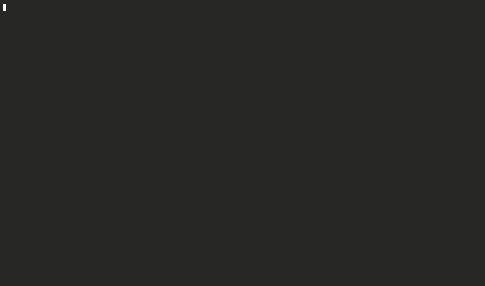

# Sources: registry in data, code stays plain

> **Experimental** — see [EXPERIMENTAL.md](../EXPERIMENTAL.md). Namespaces:
> `atlas.source` (loading sources into the registry) and `atlas.meta-source`
> (atlas's pack for [meta-source](https://github.com/semantic-namespace/meta-source),
> which reads the sources without running anything: the CLI, `check`, the
> Emacs package).

The usual way to use atlas puts the definition next to the code, as a
`register!` call. This page describes a second way. The code stays ordinary
Clojure, and each function carries one metadata key naming its entity. The
definitions live in EDN files.

```clojure
;; src/app/cart_impl.clj — nothing here requires atlas
(defn ^{:atlas.source/id :fn/get-cart} get-cart
  [{data :session/data} _]
  ...)
```

```clojure
;; registry/functions.edn
{:fn/get-cart
 {:atlas/type :atlas/execution-function
  :atlas/aspects #{:tier/service :domain/cart :operation/read}
  :execution-function/context [:session/data]
  :execution-function/response [:cart/id :cart/items :cart/user-id :cart/shipping-address :cart/guest?]
  :execution-function/deps #{}}}
```

`defn` keeps working with clj-kondo, clojure-lsp, docstrings, stack traces
and the REPL. The application compiles without atlas on the classpath, so a
team can adopt it one function at a time. The cart example is written both
ways: `test/app/cart.clj` with `register!` calls, and `test/app/cart_impl.clj`
with `test/app/cart_registry/*.edn`. `test/app/cart_source_test.clj` checks
that both produce the same registry.

## Sources and how they merge

A **source** is anything that says something about entities:

- an EDN file, written by a person or an LLM, holding a map of dev-id to entry;
- a generator, as a fn or var of no args returning `{:source label :entities {...}}`, called on every load;
- a source map given as data;
- for the index and the editor (below): a `register!` call written as data, the
  REPL's snapshot, and the registry store CI records.

The registry is the **merge** of its sources. An entity may be described by
several of them, each giving the keys it owns. Keys are qualified, so they
say who owns them. A business-modelling file can add
`:atlas/business-pattern`, or a generator can add `:mcp-tool/name`, to an
entity a developer wrote. The merge does not depend on the order the sources
are read in:

| Same entity, from several sources | Result |
|---|---|
| different keys | combined |
| the same key with the same value | fine |
| `:atlas/aspects` | the union of every source's aspects |
| any other key with different values | a **conflict**, naming every value and the sources that gave it. `:atlas/type` included. |

Sets other than aspects (deps, for example) are deliberately not unioned. A
union would hide a deletion: removing a dep in one file while another still
lists it would keep it.

Each registered entity carries `:atlas/source`, the labels of the sources
that gave it something: file paths as given, generators as symbols. It is
plain data, so it survives export and the store.

## Loading

```clojure
(require '[atlas.source :as source])

(source/load! ["app/registry/functions.edn"     ; file path or classpath resource
               "app/registry/endpoints.edn"
               #'app.tools/generate-mcp-tools]  ; generator, called on each load
              '[app.cart-impl])                 ; namespaces holding the annotated vars
```

`load!` merges the sources and finds every public var in the namespaces with
`:atlas.source/id`. It registers each entity with its var as `:atlas/impl`.
That is the var, not its value, so redefining the fn at the REPL is seen
without reloading. `load!` registers nothing and throws when:

- sources conflict;
- a var names a dev-id no source defines;
- an entity has no `:atlas/type` from any source;
- an `:atlas/execution-function` entity has no var;
- two vars claim one dev-id.

`(source/reload!)` replays every `load!` after you edit an EDN file. It
reads and checks everything before replacing anything, so a reload that
throws leaves the registry as it was. It returns
`{:added [...] :removed [...] :changed [...]}`. `forget-loads!` clears the
remembered loads, beside `atlas.registry/reset-all!` in test fixtures.

## Reading the sources without running them: meta-source

The tooling that reads a project's sources from its files, with no JVM and
no code loaded, is [meta-source](https://github.com/semantic-namespace/meta-source):
the CLI (`where`, `uses`, `deps`, `data`, `check`, `summary`), Flymake, eldoc,
`M-.` and `M-?` in Emacs. It started in atlas as `atlas.source.index` and
reads more than atlas: integrant systems, clojure.spec and malli, function
contracts, Pathom, re-frame, reitit, Datascript, and a project's own rules,
all cross-referenced by keyword. atlas's registry is one of the registries it
reads, through `atlas.meta-source/pack`.

In a project:

```sh
bbin install io.github.semantic-namespace/meta-source
```

```clojure
;; meta-source.edn, at the project root
{:registry ["registry"]
 :src ["src"]
 :packs {atlas.meta-source/pack {}            ; atlas's registry, and its meta key
         :spec {}}                            ; and whatever else the project uses
 :deps {io.github.semantic-namespace/atlas
        {:git/url "https://github.com/semantic-namespace/atlas"
         :git/sha "<a commit>" :deps/root "core"}}}
```

```sh
meta-source check --brief
meta-source where :fn/get-cart
meta-source data :cart/subtotal
```

For Emacs, meta-source's `emacs/meta-source.el` replaces the former
`atlas-source.el`: see meta-source's README.

In this checkout, `bb source <command>` runs meta-source with the pack, at the
commit `bb.edn` pins: `bb source check --root <project>`.

### What the atlas pack adds

- **`:atlas.source/id` links a defn to its entity**, with nothing to
  configure: the pack declares it as its meta key. `where`, hover and `M-.`
  give the entry and the defn; the defn's body is checked against the
  entity's context and response.

- **`register!` calls are sources.** Nothing has to move to EDN. A call to
  `atlas.registry/register!` (or `atlas.core/register!`) whose dev-id, type
  and aspects are written as data is a source, as an EDN entry is, read from
  the one form; `::keywords` are resolved with the file's namespace and
  aliases. Props given as code (an inline `:atlas/impl (fn …)`, a var
  reference) are left out and listed as dropped. Calls whose dev-id, type or
  aspects are computed are reported as not read, never guessed. A 3-argument
  call gets the dev-id `register!` would generate. A registry file and a
  `register!` call for the same entity merge like any two sources.
- **`:atlas/aspects` merge as a union**, as `atlas.source/merge-sources` does.
- **Dataflow:** `:execution-function/context` and `/response`, and the same
  for `:interface-endpoint`, `:dataflow` and `:workflow`
  (`atlas.meta-source/dataflow`). A project's own ontologies add theirs by
  declaring `:dataflow/context-key` and `:dataflow/response-key`, as
  atlas's own do: the pack reads them from the ontologies it reads, with no
  `:dataflow` line in `meta-source.edn`.

  
- **An ontology's implementation key.** `load!` puts an annotated var under
  `:atlas/impl`, unless the entity's ontology declares another with
  `:ontology/impl-key` (an endpoint's `:endpoint/handler`); an entity of
  such a type needs a var, as an execution function does, and the pack
  checks that too.

  
- **Checks**, as `atlas.source/load!` would refuse them (errors):
  `:entity-without-type`, an entity no source gives an `:atlas/type`;
  `:entity-without-impl`, an execution function given only by registry files
  with no var carrying `:atlas.source/id`; and `:var-without-entity`, a var
  carrying `:atlas.source/id` for an id no source defines, at the var.
  And `:compound-identity-shared`: two dev-ids with the same type and
  aspects, at each. The registry keys entities by compound identity, so the
  second `register!` replaces the first, and the first dev-id then resolves
  to the second's value: nothing fails until it is called.

  
- **Invariants as rules.** An `:atlas/invariant` may carry
  `:invariant/rule`: its check written as a [meta-source rule](https://github.com/semantic-namespace/meta-source/blob/main/docs/reference.md),
  beside the `:invariant/fn` that needs the running registry. The pack checks
  it from the files, with the project's own rules, at each entity it fails
  on. atlas's own carry one where a rule says exactly what the fn does, 19
  of them: tiers (endpoints in `:tier/api`, components in
  `:tier/foundation`), reasons and realizations on decisions, what a value
  proposition implements and which system delivers it, a pure function
  depending on no component, and that what a deployment, system, allium
  rule, test case, bet, scope, prompt, workflow or workflow producer names
  exists (meta-source's `:resolves`, `:refs`, `:referenced-by`). The pack
  reads atlas's from the classpath (`atlas.meta-source/builtin-rule-files`),
  and a project's own invariants from its files. Limits: a rule sees the
  aspects the code declares, not those `compile!` inherits through deps;
  "exists" is an entity some source read defines, so an entity only made at
  runtime is seen through `watch!`'s snapshot; `pure-has-no-deps` follows
  `:execution-function/deps`, where its fn follows every ontology's deps key.

  

  
- **The running registry.** `(atlas.meta-source/watch!)` in the REPL keeps
  `.meta-source/packs/atlas.edn` holding the registry as the process has it.
  meta-source fills from it what no file says (entities a generator, a loop
  or a computed `register!` call made) and reports where the code and the
  running registry disagree on an entity's type or aspects.

Coverage of `register!` calls on real code:

| | Calls read |
|---|---|
| the cart (`test/app/cart.clj`) | 20 of 20, identical to its EDN files |
| the other example apps | 127 of 127 |
| atlas `core/src` | 520 of 536 |
| a 535-file production app | 336 of 344 |

`bb atlas-pack-smoke` checks the pack on the cart and on `register!` calls.

## Sources and the store

These are two different things, not two competing formats:

- **Sources are input.** They are edited by people and LLMs, reviewed in
  PRs, keyed by dev-id, grouped as the authors like, and can hold comments.
- **The store is the record.** `atlas.store`, written by CI, holds the
  *evaluated* registry: authored entities, generated ones and ontologies.
  It is canonical, sorted and grouped by type for compact history.

The store can't be the source, because it holds entities nobody wrote and is
rewritten canonically. The sources can't be the store, because they lack the
generated entities. `:atlas/source` links the record back to the input.

## Limits

- **Declared deps aren't checked against injected deps.** `check` sees a
  linked var calling another linked var directly. It can't see a dependency
  passed in as an argument.
- **Data keys are found by the keys the ontologies name.** An ontology
  registered by a computed call, or one declaring no `:dataflow/context-key`,
  still needs `:dataflow` in `meta-source.edn`.
- **Nested data shows up as info notes.** `merge-carts` reads `:item/*` fields
  inside `:cart/items`, and its contract doesn't mention them.
- **Runtime entities are only as fresh as their snapshot.** An entity made
  at runtime is seen through `atlas.meta-source/watch!`'s snapshot, current
  while a REPL runs, with no line number. The store (`bb registry`) answers
  for a recorded ref.
- **Namespace refresh replaces vars.** With clj-reload or tools.namespace
  refresh, a reloaded namespace gets new vars; call `load!` again, as a
  system restart does. `require :reload` and CIDER evaluation keep the vars.
- **The rest of the Emacs layer still assumes `register!`.** The source pane
  in layouts, lens and `atlas-at-point` don't know about EDN sources yet;
  meta-source's package does.
