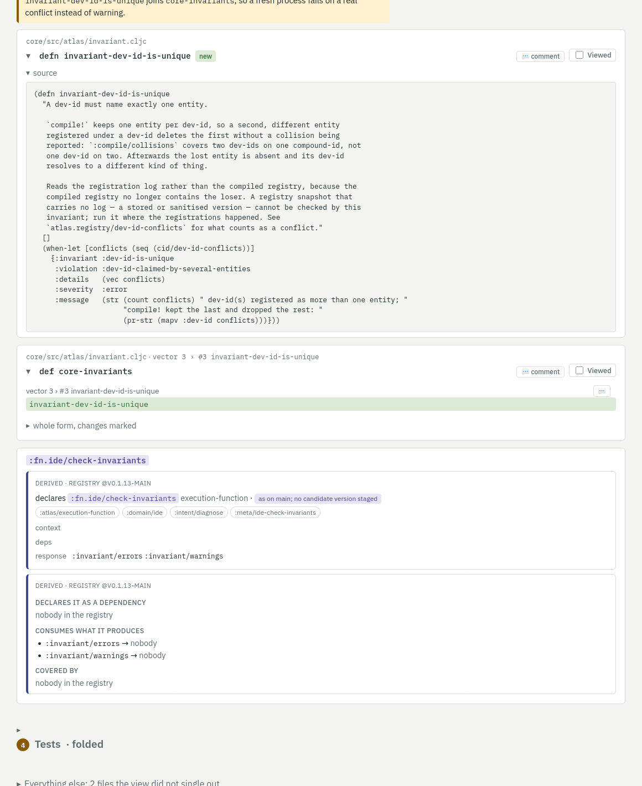
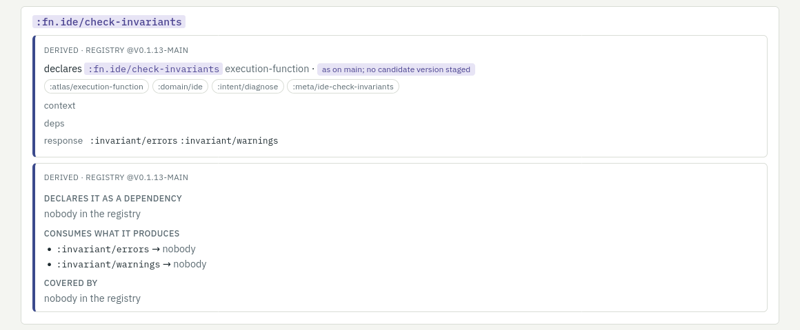

# review

The [sdiff](https://github.com/semantic-namespace/diff) review server for a
project with an atlas registry. The report page of a pull request gets
derived decorations from the registry, beside each changed form and at the
top:

- the entity a form declares, with its contract and the delta between the
  recorded version at the PR's merge base and the registry CI built for its head;
- who depends on that entity, who consumes what it produces, which test
  cases cover it;
- the data keys the changed code mentions, with their producers and consumers;
- a header listing every entity the PR's registry diff touched, linked to the
  form that changed it, or marked when no form in the diff did;
- a risk ranking from the system graph: for each changed entity, whether its
  contract changed, how many entities depend on it, which entry points
  (endpoints, MCP tools, workflows, prompts) it reaches, which services it
  talks to, whether it writes, and whether any test case covers it or what
  depends on it. Each level shows the reasons that produced it.

All of it answers through `atlas.ide` with the stored version bound as the
registry. Inferred annotations, from a reviewer or a model, render apart and
labelled.

```
clojure -M:serve --store <registry store checkout> --prefix <path inside it> [--branch origin/main] [--port 7878] [--host 127.0.0.1]
```

Two registries are compared. The candidate is the registry CI built for the
PR head, downloaded through `gh` from the workflow run's artifact
(`SDIFF_REGISTRY_WORKFLOW` and `SDIFF_REGISTRY_ARTIFACT` name them; defaults
`atlas-registry` and `registry`). When CI has no run for the head, the page
says so and shows entities as on main.

The base is a version the project's CI recorded in its registry store (the
git repository written by `atlas.store`, one commit per recorded registry,
the source sha in the commit message and a `Source-Sha:` trailer). The store
records only commits that changed the registry, and CI builds the candidate
from a merge of the PR into the line as it was then, so the base is the
newest version recorded at or before the commit the candidate was built on:

- The artifact may carry a sidecar, `atlas-registry.meta.edn`, beside
  `atlas-registry.edn`: `{:base-sha "<full sha>" :head-sha "<full sha>"}`,
  the base being the first parent of the merge commit CI built. The version
  built from that sha is used when the store has it; otherwise the newest
  version whose source is an ancestor of it (GitHub's compare, through `gh`);
  when ancestry cannot be read, the newest version the store recorded by that
  commit's time.
- Without the sidecar, the newest version the store recorded by the time the
  CI run started, and the header says the base was inferred.
- Without a candidate, the same rules over the PR's merge base.

The header says how the base was chosen: the PR's base itself, or that the
registry was unchanged from the chosen version to it. When the store has no
version that old, it compares with the oldest one and warns. When versions
were recorded on the line after the chosen one, the header marks the
candidate stale, counts them, and asks for CI to be re-run to see the PR
against the current line.

### Comparing against another store branch

A store can hold more than the line `--branch` names: a `deployed/<env>`
branch with one commit per deploy (subject `registry: <sha> deployed to <env>
from <git branch>`, trailer `Source-Sha: <full sha>`), for example. The
`against` request parameter picks one of them as the base:

```
/pr?ref=owner/repo#12&against=deployed/dev
```

From the MCP tools, pass `params` `"against=deployed/dev"`. The header and
the text output always name the base used.

- Absent, or naming the configured branch (`main` finds `origin/main`): the
  base is chosen as above.
- Another branch of the store: the base is the newest version on it, what that
  environment runs. The version on the configured
  branch, chosen as above, is read too, and the header shows the two steps,
  `<env> → merge base (merged, not yet there) → this PR`, each with its own
  new, changed and deleted entities. Per-form states and risk rows say which
  step a difference belongs to.
- The first step is called merged since the deploy only when the PR's base
  descends from what the environment runs: the environment's `Source-Sha`
  is the base version's commit or an ancestor of it, by the order of the
  line's versions when both are recorded there, else by GitHub's compare.
  An environment is often deployed from a branch that already holds newer
  line commits than the PR's base, and then the step runs backwards. The
  header then says `Differs between <env> and this PR's base: <env> runs
  <branch>; this PR is built on an older <line>` (or `on a <line> that
  diverged from it`, or just `Differs between <env> and this PR's base` when
  GitHub cannot tell), and the risk ranking lists those entities after the
  PR's own, as `context`, `differs between <env> and this PR's base, not
  this PR`, with no risk level. The counts are the same either way.
- A name that is not a branch of the store: the header says so and the base
  is chosen as when absent.

The value is matched against the store's own branches (`git for-each-ref`
over `refs/heads` and `refs/remotes`; `deployed/dev` finds
`origin/deployed/dev` when only the remote has it) and never reaches git
otherwise. Resolving it fetches the store, at most once a minute per branch,
since nothing else refreshes the checkout.

A view over a pull request of the atlas repo itself, with the registry
decoration of an entity the view names:



The entity block alone: what it declares, with its state against the base
version, and who depends on it, what consumes what it produces, which test
cases cover it:


